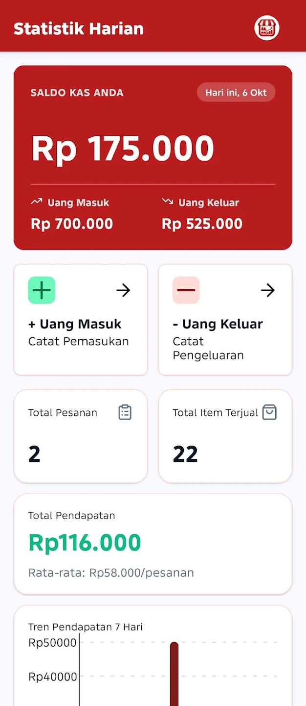
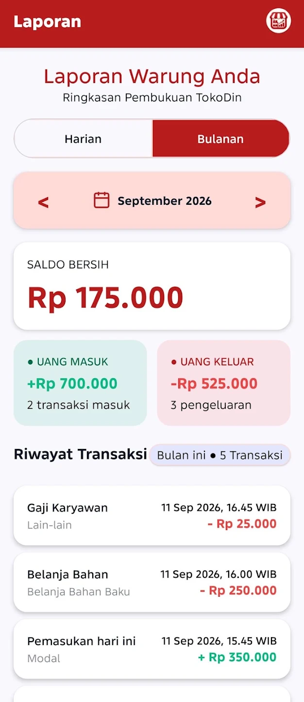

# TokoDin

Aplikasi kasir dan manajemen kas sederhana untuk warung dan UMKM Indonesia, dibangun dengan React Native dan otomasi n8n.

[](https://play.google.com/store/apps/details?id=com.umkmcommandcenter)

## Latar belakang

TokoDin berawal dari warung nasi uduk milik keluarga saya, yang tadinya mencatat kas dan pesanan secara manual. Untuk memudahkannya, saya membuat aplikasi yang bisa mencatat kas masuk dan keluar, menampilkan laporan keuangan harian dan bulanan, serta (di versi asli) menangkap pesanan dari WhatsApp secara otomatis dengan bantuan n8n.

## Fitur

**Versi Google Play (demo lokal)**
- Dashboard statistik harian
- Pencatatan kas masuk dan kas keluar
- Laporan keuangan harian dan bulanan
- Daftar pesanan dan riwayat chat (berisi data contoh)
- Halaman Akun

**Hanya di versi asli (dengan backend n8n)**
- Pencatatan pesanan otomatis dari WhatsApp dan Email
- Asisten pemesanan berbasis AI (Google Gemini) dengan memori sesi
- Sinkronisasi data ke Google Sheets
- Riwayat chat dari percakapan sungguhan

## Screenshot

<p align="center">
  
  
  
  
</p>

*Screenshot dari versi demo.*

## Tech stack

- React Native 0.86 (New Architecture) + TypeScript
- React Navigation, React Native Paper, react-native-gifted-charts, lucide-react-native
- AsyncStorage untuk penyimpanan lokal (versi demo)
- n8n (workflow automation), di-host di Railway
- Google Sheets sebagai database bisnis dan Google Gemini sebagai AI agent (versi asli)

## Dua mode aplikasi

| | Versi demo (Google Play) | Versi asli |
|---|---|---|
| Data | Lokal di perangkat | Google Sheets via n8n |
| Backend | Tidak ada | n8n di Railway |
| Akun/login | Tidak ada | Tidak ada |
| Pengguna | Publik | Dipakai untuk usaha keluarga |

Mode diatur lewat `IS_DEMO_BUILD` di `src/config.ts`.

## Status

Versi 1.0 tersedia di [Google Play](https://play.google.com/store/apps/details?id=com.umkmcommandcenter) dan berjalan dalam mode demo lokal.

Rencana ke depan: tampilan awal tanpa data contoh, dan sistem akun sebagai proyek terpisah.

## Cara menjalankan

**Prasyarat:** Node.js 22.11.0 atau lebih baru, serta lingkungan React Native CLI untuk Android (JDK, Android Studio + SDK, dan emulator atau HP dengan USB debugging). Ikuti panduan "Set Up Your Environment" di reactnative.dev, pilih Android.

1. Clone dan pasang dependensi:
   ```bash
   git clone https://github.com/mnaufal-a/tokodin.git
   cd tokodin
   npm install
   ```
2. Salin file konfigurasi: `src/config/secret.example.ts` menjadi `src/config/secret.ts`. Nilainya boleh dibiarkan seperti contoh, karena mode demo tidak memanggil backend.
3. Jalankan `npm start`, lalu di terminal lain `npm run android`.

Mode demo (`IS_DEMO_BUILD = true`) berjalan penuh secara lokal. Mode asli membutuhkan instance n8n dan Google Sheets milik sendiri, yang tidak disertakan di repo ini. Kalau muncul error `Unable to resolve module ../config/secret`, berarti langkah 2 terlewat.

## Kebijakan privasi

https://mnaufal-a.github.io/tokodin/privacy-policy.html
